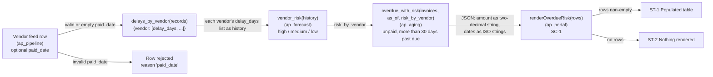
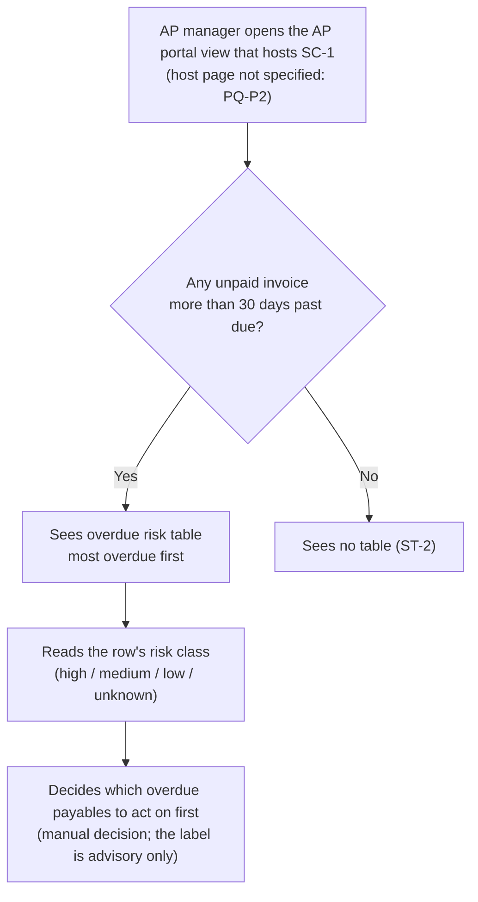

# feat.prototype: FEAT-ZD-48600

Prototype for FEAT-ZD-48600 (ZD-48600, "Show which overdue invoices belong to vendors that usually pay late"). This is a draft for the REQ-06 gate (UX lead).

The outcome is a set of low-fidelity wireframes. "Figma is not connected in this test run" (org.design_library), and the step brief lists api:github as the only connector approved for this step (record:brief). So this file holds both deliverables in text form, ready to paste:

- the **FigJam flow**: a Mermaid flow and a screen and state map
- the **Figma Make prompt**: it applies the design library, the screen inventory, the states and the synthetic data rules

The file ends with a check of the prototype against the approved PRD. Statements marked "agent judgement" are this agent's own reading; no input states them as fact. The prototype adds no function, data or behaviour beyond feat.prd. Its presentation choices (greyscale, right-aligned numbers, no row actions, wording) are labelled "design choice (agent judgement)" in section 7 and are for the UX lead to accept or change.

| Field | Value | Source |
|---|---|---|
| Trace ID | FEAT-ZD-48600 | record:brief; feat.prd |
| Trigger | PRD Reviewed | record:brief |
| Owner / gate of this step | PM / UX lead | record:brief |
| Inputs | feat.prd (approved PRD); org.design_library (feature override, text form) | record:brief |
| UI repository in scope | ap_portal, whose portal table is S-6. Agent judgement: the PRD names no other screen, so this is the only UI surface the prototype covers | feat.prd (sections 1, 3.5) |
| UI surface | One table component, `renderOverdueRisk(rows)`, inside the AP portal | feat.prd (AC-19 to AC-21) |
| Fidelity | Low Fidelity Wireframes. Design choice (agent judgement): greyscale boxes and text, no colour, no final typography | record:brief |
| Figma / FigJam | Not connected; the text form is provided instead. The only connector approved for this step is api:github | org.design_library; record:brief |

## 1. Design system applied

org.design_library gives the design rules for this feature in text form. The prototype uses each one exactly as written and adds no other token.

| # | Design-library rule (quoted) | Applied in the prototype | Source |
|---|---|---|---|
| DL-1 | "overdue risk table uses class 'overdue-risk'" | The table frame is named and classed `overdue-risk` | org.design_library; feat.prd (AC-19) |
| DL-2 | "each row has class 'risk-high', 'risk-medium', 'risk-low' or 'risk-unknown'" | Each body row carries one of the four row classes, matching the row's `risk` value | org.design_library; feat.prd (AC-20) |
| DL-3 | "columns Invoice, Vendor, Days overdue, Amount (two decimals)" | Four columns, in this order and with these exact headings. Amount is always shown with two decimals | org.design_library; feat.prd (AC-19) |
| DL-4 | "render nothing when there are no rows" | The empty state is no table at all: no header, no placeholder text | org.design_library; feat.prd (AC-21) |

**Not in the design library.** The library defines no colour, spacing or typography variables (tokens), no visual style for the `risk-*` classes and no host page layout. The wireframes stay greyscale and show each row class as an annotation, not as a colour. Visual tokens are left to the UX lead (PQ-P1).

**Amount display.** feat.prd NFR-3 says ap_portal shows the amount to two decimals "without converting it to a binary floating-point number". How it does this is left to the TRD (REQ-07), and OQ-B10 is open. So the prototype shows the two-decimal amount string exactly as it arrives from ap_aging (AC-18) and sets no formatting rule of its own.

## 2. Screen inventory

| ID | Screen / component | Purpose | User story | Source |
|---|---|---|---|---|
| SC-1 | Overdue risk table (`renderOverdueRisk`) in the AP portal | Lists unpaid invoices more than 30 days past due, each row classed by vendor risk, most overdue first | US-1 | feat.prd (US-1, AC-13, AC-16, AC-19, AC-20) |

The PRD defines only this one UI surface. The flow stages before it (feed, delays, risk, overdue list) run without any screen. They appear in the FigJam flow (section 4) for context only. The host page that holds SC-1 (navigation, title, filters) is not specified in the inputs and is not designed here (PQ-P2).

## 3. States

| ID | State | Trigger | What is shown | Source |
|---|---|---|---|---|
| ST-1 | Populated | `rows` is non-empty | `<table class="overdue-risk">` with the header row Invoice / Vendor / Days overdue / Amount and one `<tr class="risk-RISK">` per row | feat.prd (AC-19); org.design_library |
| ST-2 | Empty | `rows` is empty | Nothing: `renderOverdueRisk` returns an empty string, so no table, header or message | feat.prd (AC-21); org.design_library |
| ST-3 | Row risk variants | Row `risk` is `high`, `medium`, `low` or `unknown` | The same row layout. Only the row class changes (`risk-high`, `risk-medium`, `risk-low`, `risk-unknown`) | feat.prd (AC-20); org.design_library |
| ST-4 | Unknown vendor risk | Vendor has no entry in `risk_by_vendor` | The row is shown with class `risk-unknown` | feat.prd (AC-17, AC-20) |
| ST-5 | Days tie | Two rows have the same `days` | The rows are ordered by `id`; P-A2 assumes ascending text order, still to be confirmed (PQ-2) | feat.prd (AC-16, P-A2, PQ-2) |

**States not designed.** The PRD defines no loading, error, pagination or overflow state for the table, so none is designed (PQ-P3).

**Risk as visible text.** OQ-B9 is open. Following AC-19, the risk level is carried only by the row class, with no visible Risk column or text. Agent judgement: if `risk-*` is later styled with colour alone, risk would be signalled by colour only, which is an accessibility concern. The UX lead should weigh this when answering OQ-B9 (PQ-P4).

## 4. FigJam flow (text form)

### 4.1 Data-to-screen flow (context; only the last stage is a screen)



Sources: feat.prd (AC-1 to AC-4, AC-7 to AC-9, AC-13, AC-18, AC-19, AC-21, AC-23, section 1 "Flow").

### 4.2 User flow (AP manager)



Sources: feat.prd (US-1, AC-13, AC-16, AC-21, B-A1, NFR-6). The decision step is manual: "No risk value shall trigger an automatic action, posting or payment" (feat.prd NFR-6).

## 5. Low-fidelity wireframes

All data in the wireframes is synthetic (section 6). The `[risk-…]` tags in the left margin are designer annotations showing each row's class. They are **not** rendered text (OQ-B9).

### WF-1: SC-1, ST-1 Populated (includes ST-3, ST-4 and ST-5)

```
 AP portal  (host page not specified: PQ-P2)
                 table.overdue-risk
                ┌─────────────┬──────────────────────┬──────────────┬─────────────┐
                │ Invoice     │ Vendor               │ Days overdue │      Amount │
                ├─────────────┼──────────────────────┼──────────────┼─────────────┤
 [risk-high]    │ SYN-INV-004 │ Synthetic Vendor A   │           75 │     1250.00 │
 [risk-medium]  │ SYN-INV-002 │ Synthetic Vendor B   │           42 │      980.50 │
 [risk-unknown] │ SYN-INV-003 │ Synthetic Vendor D   │           42 │       15.00 │
 [risk-low]     │ SYN-INV-001 │ Synthetic Vendor C   │           31 │      300.00 │
                └─────────────┴──────────────────────┴──────────────┴─────────────┘
 Annotations:
  - Order: Days overdue descending; the synthetic tie is ordered by id ascending (P-A2, PQ-2).
  - Amount: the two-decimal string from ap_aging, shown as received (NFR-2, NFR-3).
  - Row class only; no visible Risk column (AC-19, OQ-B9).
  - SYN-INV-003: vendor has no risk entry, so class risk-unknown (AC-17).
  - Not shown: an unpaid invoice exactly 30 days past due (AC-14) and any paid invoice (AC-15).
```

### WF-2: SC-1, ST-2 Empty

```
 AP portal  (host page not specified: PQ-P2)
 ┌────────────────────────────────────────────────────────────────────┐
 │                                                                    │
 │   (nothing rendered: renderOverdueRisk returns "")                 │
 │                                                                    │
 └────────────────────────────────────────────────────────────────────┘
 Annotation: no table, no header, no "no results" message (AC-21; org.design_library).
 The text in brackets above is a designer note, not UI.
```

## 6. Synthetic data rules and dataset

**Rules.** The workbook action names "synthetic data rules" (record:brief), but neither the brief nor any input defines them. The rules below are agent judgement, chosen to keep the prototype safe and to exercise the PRD (PQ-P5).

| # | Rule | Why | Source |
|---|---|---|---|
| SD-1 | Synthetic data only: ids prefixed `SYN-INV-`, vendor names "Synthetic Vendor <letter>"; no real vendor, person, bank or contact data | Keeps real vendor and contact data out of a design artefact (agent judgement) | agent judgement |
| SD-2 | Amounts are two-decimal strings, never floats | Decimal amounts; JSON carries amounts as two-decimal strings | feat.prd (AC-18, NFR-1, NFR-2); record:memory (D-2026-044, L-011) |
| SD-3 | Every displayed row is unpaid and more than 30 days past due; the dataset also lists one row exactly 30 days past due and one paid row, both marked "not shown" | Shows the boundary and the paid-invoice exclusion | feat.prd (AC-13, AC-14, AC-15); record:memory (L-007, D-2026-050) |
| SD-4 | Include all four risk values, including one vendor with no risk entry | Covers every row class | feat.prd (AC-17, AC-20) |
| SD-5 | Include a tie on `days` | Shows the `id` tie-break | feat.prd (AC-16) |
| SD-6 | Values are illustrative and are not facts about any vendor | Prototype data must not be read as evidence | agent judgement |

**Dataset (synthetic, illustrative; the numbers are made-up values, not facts).**

| id | vendor | days | amount | risk | paid | Shown in WF-1 |
|---|---|---|---|---|---|---|
| SYN-INV-004 | Synthetic Vendor A | 75 | "1250.00" | high | no | Yes, row 1 |
| SYN-INV-002 | Synthetic Vendor B | 42 | "980.50" | medium | no | Yes, row 2 |
| SYN-INV-003 | Synthetic Vendor D | 42 | "15.00" | unknown (no entry) | no | Yes, row 3 |
| SYN-INV-001 | Synthetic Vendor C | 31 | "300.00" | low | no | Yes, row 4 |
| SYN-INV-005 | Synthetic Vendor A | 30 | "400.00" | high | no | No: exactly 30 days (AC-14) |
| SYN-INV-006 | Synthetic Vendor B | 90 | "220.00" | medium | yes | No: paid (AC-15) |

## 7. Figma Make prompt

Paste the block below into Figma Make once a Figma connection is available. Until then it is the specification for the text wireframes above.

```
Build a LOW-FIDELITY, greyscale wireframe of one component for the Hobasa AP portal:
the "Overdue risk table". Do not add colour, icons, brand tokens, charts or extra
screens. Do not add a page shell, navigation, filters or search; the host page is
not specified.

Component
- An HTML-style table named and classed "overdue-risk".
- Exactly four columns, in this order, with these headings:
  Invoice | Vendor | Days overdue | Amount
- Amount is right-aligned and always shows two decimals. Display the amount string
  exactly as given; do not reformat it through a floating-point number.
- One body row per item. Each row carries exactly one class: risk-high,
  risk-medium, risk-low or risk-unknown, matching the row's risk value.
  Show the class as a small grey margin annotation outside the table
  (e.g. "[risk-high]"). Do NOT add a visible Risk column or risk text inside the
  table.
- Rows are sorted by Days overdue, highest first; ties are sorted by Invoice id
  ascending.
- "Days overdue" is a count of calendar days after the due date.

Frames
1. "WF-1 Populated": the table with these synthetic rows, in this order:
   SYN-INV-004 | Synthetic Vendor A | 75 | 1250.00 | risk-high
   SYN-INV-002 | Synthetic Vendor B | 42 | 980.50  | risk-medium
   SYN-INV-003 | Synthetic Vendor D | 42 | 15.00   | risk-unknown
   SYN-INV-001 | Synthetic Vendor C | 31 | 300.00  | risk-low
   Add sticky notes: "Exactly 30 days past due is not listed",
   "Paid invoices are not listed", "Risk is advisory only; no automatic action".
2. "WF-2 Empty": an empty frame with only a designer note:
   "renderOverdueRisk returns an empty string: no table, no header, no message".

Rules
- Use synthetic data only (ids SYN-INV-*, vendors "Synthetic Vendor <letter>").
  No real names, people, emails, bank details or amounts.
- Use the word "overdue"; avoid the label "Late" (recommendation; still open).
- No buttons or actions on rows (no pay, post, approve or chase buttons).
```

Where each prompt rule comes from:

| Prompt rule | Basis | Source |
|---|---|---|
| Class `overdue-risk`; four columns and headings; two-decimal amount; row classes; empty frame | Design library and PRD | org.design_library; feat.prd (AC-19, AC-20, AC-21) |
| Show the amount string as given, no floating-point reformatting | PRD | feat.prd (AC-18, NFR-2, NFR-3, OQ-B10) |
| Sort by days descending, then id ascending | PRD and assumption | feat.prd (AC-16, P-A2) |
| Calendar days | Decision | record:memory (D-2026-031); feat.prd (B-A2) |
| Sticky notes: 30-day boundary, paid excluded, advisory only | PRD | feat.prd (AC-14, AC-15, NFR-6) |
| No visible Risk column; margin annotation | PRD default while OQ-B9 is open; the annotation style is a design choice (agent judgement) | feat.prd (AC-19, OQ-B9) |
| Avoid "Late" | PRD recommendation; OQ-B2 open | feat.prd (NFR-10, OQ-B2) |
| Synthetic data only | Synthetic data rules SD-1 to SD-6, which are agent judgement. The workbook action names synthetic data rules but defines none (PQ-P5) | section 6; record:brief |
| Greyscale; no colour, icons, tokens or charts | Design choice (agent judgement): low fidelity, and the design library defines no tokens | record:brief; org.design_library |
| Amount right-aligned | Design choice (agent judgement); the design library does not set alignment | org.design_library |
| No row buttons or actions | Design choice (agent judgement). NFR-6 forbids only automatic action, and the PRD defines no manual row action, so none is drawn (PQ-P7) | feat.prd (NFR-6, section 3.5) |
| No page shell, navigation or filters | The host page is not specified (PQ-P2) | feat.prd (AC-19) |

## 8. Check of the prototype against the PRD

| PRD item | Requirement (short) | Prototype | Result | Source |
|---|---|---|---|---|
| US-1 | AP manager sees unpaid invoices more than 30 days past due, each with the vendor's risk, sorted most overdue first | WF-1; user flow 4.2 | Pass | feat.prd (US-1) |
| AC-13 / AC-14 / AC-15 | Unpaid and more than 30 days only; exactly 30 excluded; paid excluded | Dataset SD-3; WF-1 annotations; prompt sticky notes | Pass (shown as data rules; the filter itself is in ap_aging) | feat.prd (AC-13, AC-14, AC-15) |
| AC-16 | Keys `id`, `vendor`, `days`, `amount`, `risk`; sort by `days` descending, then `id` | WF-1 order; prompt "Rows are sorted…" | Pass. The `id` direction follows P-A2, still to be confirmed (PQ-2) | feat.prd (AC-16, P-A2) |
| AC-17 | Vendor with no risk entry gets `'unknown'` | SYN-INV-003, `risk-unknown` | Pass | feat.prd (AC-17) |
| AC-18 / NFR-1 / NFR-2 / NFR-3 | Decimal amount; two-decimal string in JSON; display without a binary float | SD-2; amount shown as received; prompt "do not reformat it through a floating-point number" | Pass at prototype level. How ap_portal formats the amount is left to the TRD (OQ-B10) | feat.prd (AC-18, NFR-1 to NFR-3, OQ-B10) |
| AC-19 | `<table class="overdue-risk">`, one `<tr class="risk-RISK">` per row, columns Invoice, Vendor, Days overdue, Amount (two decimals) | WF-1; DL-1, DL-3 | Pass | feat.prd (AC-19); org.design_library |
| AC-20 | Row class `risk-high` / `risk-medium` / `risk-low` / `risk-unknown` matches `risk` | WF-1 annotations; ST-3 | Pass | feat.prd (AC-20); org.design_library |
| AC-21 | No rows: return an empty string | WF-2; ST-2; DL-4 | Pass | feat.prd (AC-21); org.design_library |
| NFR-6 | Risk label advisory only; no automatic action | No row actions; user flow ends in a manual decision; prompt forbids action buttons | Pass | feat.prd (NFR-6) |
| NFR-7 / OQ-B8 | HTML-escaping of vendor names and ids is open | Synthetic names hold no markup; escaping is not decided here | Open, carried (OQ-B8) | feat.prd (NFR-7, OQ-B8) |
| NFR-10 / OQ-B2 | Keep "overdue" distinct from the regulatory "Late" | Only "overdue" / "Days overdue" are used; the prompt asks to avoid "Late" | Pass (the recommendation is followed; OQ-B2 stays open) | feat.prd (NFR-10, OQ-B2) |
| OQ-B9 | Risk as visible text or row class only | Row class only, with margin annotations | Follows AC-19 until answered; flagged (PQ-P4) | feat.prd (OQ-B9, AC-19) |
| Scope | No new scope beyond S-1 to S-7 | One component, two states; no host page, filters, export or actions. Presentation choices are labelled as agent judgement (section 7) | Pass | feat.prd (section 1 "Not in this change", section 8) |
| Decision log | D-2026-031, D-2026-044, D-2026-050 | "Days overdue" is stated as calendar days after the due date (prompt rule); two-decimal string amounts; paid rows not shown | No conflict | record:memory; feat.prd (B-A2, section 8) |

No conflict with the approved PRD or with a recorded decision was found.

## 9. Open questions

### 9.1 New in this step (non-blocking)

| ID | Question | Why it matters | Source |
|---|---|---|---|
| PQ-P1 | What visual tokens (colour, weight, icon) should style `risk-high`, `risk-medium`, `risk-low` and `risk-unknown`? The design library defines none. | Needed before hi-fi design and front-end styling | org.design_library |
| PQ-P2 | Which portal page hosts the overdue risk table, and where on that page? | Placement and navigation are not designed here | feat.prd (AC-19); org.design_library |
| PQ-P3 | Are loading, error, pagination or long-list states needed? The PRD defines none, and data volume targets are open (PQ-4). | Completeness of states | feat.prd (AC-19 to AC-21, PQ-4) |
| PQ-P4 | If risk stays as a row class only (OQ-B9), how is it made perceivable without relying on colour alone? (agent judgement: accessibility concern) | Accessibility of the risk signal | feat.prd (OQ-B9) |
| PQ-P5 | Is there an approved synthetic data rule set for prototypes? None was among this step's inputs; SD-1 to SD-6 are agent judgement. | Prototype data governance | section 6 |
| PQ-P6 | Should Figma / FigJam be connected (capability request) so the flow and prompt can be produced as Figma files? | Delivery format of the prototype | org.design_library; record:brief |
| PQ-P7 | Should rows offer any manual action (for example, open the invoice)? The PRD defines none, so none is drawn. | Interaction scope | feat.prd (section 3.5, NFR-6) |

### 9.2 Carried from the approved PRD (unchanged)

OQ-B1 to OQ-B10 and PQ-1 to PQ-6 are carried unchanged from feat.prd (section 6). So are the questions feat.prd carries from earlier steps: feat.fitment FQ-3, FQ-5 and FQ-6, OQ-1 to OQ-5 from feat.classification, and Q-1 to Q-5 from feat.prebacklog. The ones that touch this prototype are OQ-B2 ("overdue" vs "Late"), OQ-B8 (HTML escaping), OQ-B9 (visible risk text), OQ-B10 (amount formatting without a float) and PQ-2 (direction of the `id` tie-break).
