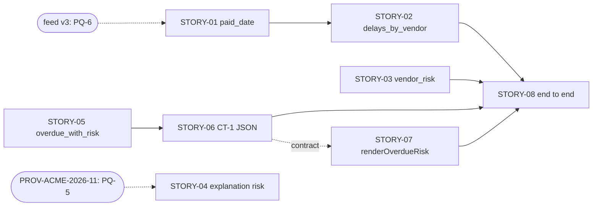

# feat.stories: FEAT-ZD-48600

User stories for FEAT-ZD-48600 (ZD-48600, "Show which overdue invoices belong to vendors that usually pay late"). This is a draft for the REQ-08 gate (PM).

This file breaks the approved PRD, prototype and TRD down into one epic, five features, eight stories and their tasks. Each story has numbered acceptance criteria in Gherkin (Given / When / Then), its dependencies, its specification depth, links to the prototype frames, its assumptions and its open items. Every story is in state **NEW**. This file adds no scope beyond feat.prd S-1 to S-7. It sets no priority, iteration or estimate, because backlog prioritisation is not a Requirement agent action.

Statements marked "agent judgement" are this agent's own reading; no input states them as fact. Acceptance criteria marked **[Pending &lt;ID&gt;]** follow an interim design or an assumption that still depends on an open question. If the answer differs, only that criterion changes.

Story, feature, task and criterion IDs in this file (EP-, FT-, STORY-, TK-, AC-nn.n, SA-, SQ-) are labels assigned in this step. They are not taken from any input.

**Revision note (attempt 2).** The story content is unchanged from attempt 1, after the verifier's corrections. In the structured result, the claims now describe stories by their function instead of these labels, because the labels are not in any cited input.

| Field | Value | Source |
|---|---|---|
| Trace ID | FEAT-ZD-48600 | record:brief; feat.prd |
| Trigger | Prototype approved | record:brief |
| Owner / gate of this step | PM / PM | record:brief |
| Inputs | feat.prd (approved PRD), feat.prototype (approved prototype), feat.trd (approved TRD), org.templates | record:brief |
| Story template | "ID, title, As a/I want/So that, acceptance criteria in Gherkin (Given/When/Then), assumptions, open items" | org.templates |
| Story state | NEW (all stories) | record:brief |
| Repositories / lanes | ap_pipeline → Data Engineering; ap_forecast → Data Science; ap_aging → Backend; ap_portal → Frontend; integration and end-to-end across all four → Testing Agent | feat.trd (header, "Coding lanes (routing)") |
| Risk tier (advisory) | T2; "The risk label is advisory only." | feat.trd (header); feat.prd (NFR-6) |
| Architecture rule | "Keep every existing signature; add new functions." | feat.trd (header); feat.prd (NFR-4) |
| Other files read | `tests/test_pipeline.py`, `tests/test_forecast.py`, `tests/test_aging.py` (where the new unit tests go); `src/ap_forecast/predict.py` | file:ap-pipeline-sample/tests/test_pipeline.py; file:ap-forecast-sample/tests/test_forecast.py; file:ap-aging-sample/tests/test_aging.py; file:ap-forecast-sample/src/ap_forecast/predict.py |

## 1. Decomposition

```
EP-1  Overdue invoices with vendor risk (FEAT-ZD-48600)
├── FT-1  Vendor payment-delay history          (ap_pipeline, Data Engineering)
│   ├── STORY-01  Accept the optional paid_date in the vendor feed
│   └── STORY-02  Build each vendor's payment-delay history
├── FT-2  Vendor risk level and explanation     (ap_forecast, Data Science)
│   ├── STORY-03  Give each vendor a rule-based risk level
│   └── STORY-04  State the risk level in the payment-delay explanation
├── FT-3  Overdue list with risk                (ap_aging, Backend)
│   ├── STORY-05  List unpaid invoices more than 30 days past due with vendor risk
│   └── STORY-06  Hand the overdue list to the portal as JSON (contract CT-1)
├── FT-4  Portal overdue risk table             (ap_portal, Frontend)
│   └── STORY-07  Render the overdue risk table
└── FT-5  End-to-end proof                      (cross-repository, Testing Agent)
    └── STORY-08  Prove feed → delays → risk → overdue list → portal table
```

| Level | ID | Title | PRD | TRD | Repository / lane | Source |
|---|---|---|---|---|---|---|
| Epic | EP-1 | Overdue invoices with vendor risk | US-1 to US-5; S-1 to S-7 | C-1 to C-10 | All four | feat.prd (sections 1, 2, 7); feat.trd (section 1) |
| Feature | FT-1 | Vendor payment-delay history | US-2; AC-1 to AC-6 | C-1, C-2, C-3 | ap_pipeline / Data Engineering | feat.prd (3.1, 3.2); feat.trd (C-1 to C-3) |
| Feature | FT-2 | Vendor risk level and explanation | US-3, US-4; AC-7 to AC-12 | C-4, C-5 | ap_forecast / Data Science | feat.prd (3.3); feat.trd (C-4, C-5) |
| Feature | FT-3 | Overdue list with risk | US-1; AC-13 to AC-18 | C-6, C-7 | ap_aging / Backend | feat.prd (3.4); feat.trd (C-6, C-7) |
| Feature | FT-4 | Portal overdue risk table | US-1; AC-19 to AC-21 | C-8, C-9 | ap_portal / Frontend | feat.prd (3.5); feat.trd (C-8, C-9); feat.prototype (SC-1) |
| Feature | FT-5 | End-to-end proof | US-5; AC-22, AC-23 | C-10 | Cross-repository / Testing Agent | feat.prd (3.6); feat.trd (C-10, IF-8) |

## 2. Dependencies

| Story | Depends on | Kind | Why | Source |
|---|---|---|---|---|
| STORY-02 | STORY-01 | Code (same lane) | `delays_by_vendor` reads the `paid_date` key that STORY-01 adds to each record | feat.trd (IF-1.6, IF-2.1) |
| STORY-06 | STORY-05 | Code (same lane) | The serialiser takes the rows that `overdue_with_risk` returns | feat.trd (C-7, IF-6) |
| STORY-07 | STORY-06 (contract CT-1 only) | Contract | The portal renders CT-1 rows. It can be built in parallel against the CT-1 field list; it does not need the serialiser code | feat.trd (IF-6, IF-7) |
| STORY-08 | STORY-01, 02, 03, 05, 06, 07 | Code (cross-lane) | The end-to-end wiring calls each of these functions | feat.trd (IF-8) |
| STORY-01 | Feed v3 availability (external) | External | CR-1 needs feed v3, while ZD-48470 brings feed v2 (PQ-6, R-4) | feat.prd (PQ-6); feat.trd (R-4) |
| STORY-04 | PROV-ACME-2026-11 (external) | External | Both change `build_explanation_request`; their order is not decided (PQ-5, R-3) | feat.prd (PQ-5); feat.trd (R-3) |

STORY-03 and STORY-05 have no code dependency: `vendor_risk` uses the existing `predict_delay_days`, and `overdue_with_risk` is a pure function over records that already carry `vendor` (feat.trd F-2, F-6, F-11). STORY-04 is not part of the end-to-end flow, because IF-8 does not call `build_explanation_request` (agent judgement from feat.trd IF-8).



Only the dependencies above apply between stories. Stories in different lanes with no dependency between them can be built in parallel (agent judgement).

## 3. Specification depth

The scale is agent judgement. It tells the coding lanes how much of a story is settled.

| Depth | Meaning |
|---|---|
| D3 Full | Signature, rules and test cases are specified in the TRD, and no acceptance criterion depends on an open question |
| D2 Full with pending items | As D3, but one or more acceptance criteria rest on an assumption or an interim TRD design that depends on an open question (marked [Pending &lt;ID&gt;]) |
| D1 Outline | Behaviour known, rules or tests not yet specified (no story is at this depth) |

| Story | Depth | Pending items |
|---|---|---|
| STORY-01 | D2 | OQ-B6, TQ-10 |
| STORY-02 | D2 | OQ-B6 (unpaid record with a `paid_date`) |
| STORY-03 | D2 | PQ-1 (empty history), TQ-5 (early payments counted as 0) |
| STORY-04 | D2 | TQ-4, TQ-8, PQ-5 |
| STORY-05 | D2 | TQ-9, PQ-2 (P-A1, P-A2) |
| STORY-06 | D2 | TQ-3 (CT-1 approval) |
| STORY-07 | D2 | OQ-B8, OQ-B9, OQ-B10, TQ-6, TQ-7, TQ-11, PQ-P7 |
| STORY-08 | D2 | PQ-2 (P-A4) |

No story is at D3, because every story has at least one criterion that rests on an open question.

## 4. Stories

### STORY-01 Accept the optional paid_date in the vendor feed

| Field | Value | Source |
|---|---|---|
| ID / state | STORY-01 / NEW | record:brief |
| Epic / feature | EP-1 / FT-1 | section 1 |
| Repository / lane | ap_pipeline / Data Engineering | feat.trd (header, C-1) |
| As a | AP manager | feat.prd (US-2) |
| I want | the vendor feed to carry the date each invoice was actually paid | feat.prd (US-2, AC-1, AC-2) |
| So that | the payment-delay history can be built from real settlement dates | feat.prd (US-2) |
| PRD trace | AC-1, AC-2, AC-3; NFR-4, NFR-5, NFR-9 | feat.prd |
| TRD trace | C-1, C-3; IF-1.1 to IF-1.7; D-1, D-2, D-3; T-1, T-2, T-3 | feat.trd |
| Frame links | No screen. Flow: feat.prototype section 4.1, nodes "Vendor feed row" and "Row rejected, reason 'paid_date'" | feat.prototype (4.1) |
| Depends on | Feed v3 availability (PQ-6) | feat.prd (PQ-6); feat.trd (R-4) |
| Specification depth | D2 (OQ-B6, TQ-10) | section 3 |
| Priority / estimate | Not set (PM) | record:brief |

**Acceptance criteria**

| # | Given | When | Then | Traces to |
|---|---|---|---|---|
| AC-01.1 | a feed with a `paid_date` column and a row whose `paid_date` is empty | `transform.to_model(rows)` runs | the row is accepted and its record has `paid_date` = None | PRD AC-1; IF-1.2; T-1 |
| AC-01.2 | a feed with no `paid_date` column (feed v2) | `to_model` runs | rows load as today and each record has `paid_date` = None; a missing column, None and an empty value are treated the same | IF-1.1; T-1; R-4 |
| AC-01.3 | a row marked paid whose `paid_date` is a valid ISO date | `to_model` runs | the record's `paid_date` is that date, parsed with `date.fromisoformat` | PRD AC-2; IF-1.3; T-1 |
| AC-01.4 | a row that passes today's checks and whose `paid_date` is not empty and not a valid ISO date (for example `"2026-13-01"` or `"not-a-date"`) | `to_model` runs | the row is added to `rejected` as `{"row": r, "reason": "paid_date"}` and no record is added | PRD AC-3; IF-1.4; T-2 |
| AC-01.5 | a row was rejected with reason `'paid_date'` | `quality_report(records, rejected)` runs | `reject_reasons` lists `'paid_date'`, with no change to `dq.py` | F-4; C-3; T-2 |
| AC-01.6 **[Pending TQ-10]** | a row that fails today's checks and also has an invalid `paid_date` | `to_model` runs | the row keeps today's reason (an exception type name such as `ValueError`), not `'paid_date'` | IF-1.5; T-A3; T-3 |
| AC-01.7 **[Pending OQ-B6]** | an unpaid row with a valid `paid_date` | `to_model` runs | the row is accepted and the parsed date is kept on the record | IF-1.7; R-11 |
| AC-01.8 | any accepted row | `to_model` runs | the signature and the `(records, rejected)` return shape are unchanged, every existing key and value is unchanged, and the existing tests in `tests/test_pipeline.py` still pass | IF-1.6; NFR-4; T-3 |

**Tasks**

| # | Task | Source |
|---|---|---|
| TK-01.1 | In `src/ap_pipeline/transform.py`, read `paid_date` as in IF-1.1 to IF-1.3 and add the `paid_date` key to each record | feat.trd (C-1, IF-1) |
| TK-01.2 | Add the `'paid_date'` reject path, checked after today's field checks (IF-1.4, IF-1.5) | feat.trd (F-3, IF-1.4, IF-1.5) |
| TK-01.3 | Unit tests T-1, T-2 and T-3, including a v2 feed with no `paid_date` column. Agent judgement: add them to `tests/test_pipeline.py` | feat.trd (section 5); file:ap-pipeline-sample/tests/test_pipeline.py |
| TK-01.4 | Keep CI green: compile, tests, coverage of at least 90%, static checks; Python 3.9 syntax only | feat.trd (F-14, F-15) |
| TK-01.5 | Propose the package version step (`0.4.0` today), for the lane to confirm | feat.trd (T-A6, F-2) |

**Assumptions:** B-A5, P-A3, T-A3 (section 5). **Open items:** OQ-B6, TQ-10, PQ-6 (section 6).

### STORY-02 Build each vendor's payment-delay history

| Field | Value | Source |
|---|---|---|
| ID / state | STORY-02 / NEW | record:brief |
| Epic / feature | EP-1 / FT-1 | section 1 |
| Repository / lane | ap_pipeline / Data Engineering | feat.trd (C-2) |
| As a | AP manager | feat.prd (US-2) |
| I want | each vendor's payment-delay history to be built from the date each invoice was actually paid | feat.prd (US-2) |
| So that | the risk level reflects how late the vendor's invoices have actually been settled | feat.prd (US-2) |
| PRD trace | AC-4, AC-5, AC-6 | feat.prd |
| TRD trace | C-2; IF-2.1 to IF-2.6; D-4; T-4; R-5 | feat.trd |
| Frame links | No screen. Flow: feat.prototype section 4.1, node `delays_by_vendor(records)` | feat.prototype (4.1) |
| Depends on | STORY-01 | section 2 |
| Specification depth | D2 (OQ-B6) | section 3 |
| Priority / estimate | Not set (PM) | record:brief |

**Acceptance criteria**

| # | Given | When | Then | Traces to |
|---|---|---|---|---|
| AC-02.1 | paid records that have a `paid_date` | `delays_by_vendor(records)` is called | it returns `{vendor: [delay_days, ...]}` where `delay_days = (paid_date - due_date).days`, an int | PRD AC-4; IF-2.3 |
| AC-02.2 | several qualifying records for one vendor | `delays_by_vendor` is called | that vendor's values are in feed order, and vendors appear in the order each is first seen | PRD AC-4; IF-2.4 |
| AC-02.3 | a record marked paid with no `paid_date` | `delays_by_vendor` is called | the record is left out of the history and is not rejected | PRD AC-5; IF-2.2; B-A5 |
| AC-02.4 | a paid record whose `paid_date` is before its `due_date` | `delays_by_vendor` is called | the negative `delay_days` is kept as computed, with no floor | PRD AC-6; IF-2.3; B-A4 |
| AC-02.5 | an unpaid record with no `paid_date` | `delays_by_vendor` is called | the record is left out of the history | PRD AC-4; IF-2.2 |
| AC-02.6 **[Pending OQ-B6]** | an unpaid record that has a valid `paid_date` (accepted under the interim design of AC-01.7) | `delays_by_vendor` is called | the record is left out of the history, because it is unpaid | IF-2.2; IF-1.7; T-4 |
| AC-02.7 | a vendor with no qualifying record | `delays_by_vendor` is called | the vendor has no key in the result | IF-2.5 |
| AC-02.8 | any input | `delays_by_vendor` is called | it does no I/O and does not change `records` (TRD design, agent judgement) | IF-2.6 |

**Tasks**

| # | Task | Source |
|---|---|---|
| TK-02.1 | Add `delays_by_vendor(records: List[Dict]) -> Dict[str, List[int]]` in a new module `src/ap_pipeline/delays.py` | feat.trd (C-2, IF-2, T-A4) |
| TK-02.2 | Unit test T-4 | feat.trd (section 5) |
| TK-02.3 | Keep CI green (coverage of at least 90%, static checks, Python 3.9) | feat.trd (F-14, F-15) |

**Assumptions:** B-A2, B-A4, B-A5, T-A4. **Open items:** OQ-B6; TQ-5 (early payments count as 0 later, in the prediction; see STORY-03).

### STORY-03 Give each vendor a rule-based risk level

| Field | Value | Source |
|---|---|---|
| ID / state | STORY-03 / NEW | record:brief |
| Epic / feature | EP-1 / FT-2 | section 1 |
| Repository / lane | ap_forecast / Data Science | feat.trd (C-4) |
| As a | AP manager | feat.prd (US-3) |
| I want | each vendor to get a risk level from a fixed, explicit rule on its predicted delay, with no LLM involved | feat.prd (US-3) |
| So that | I can trust and trace why a vendor is marked high, medium or low | feat.prd (US-3) |
| PRD trace | AC-7, AC-8, AC-9, AC-10; NFR-5, NFR-8 | feat.prd |
| TRD trace | C-4; IF-3.1 to IF-3.4; D-5; S-3; T-5, T-6; R-5, R-6 | feat.trd |
| Frame links | No screen. Flow: feat.prototype section 4.1, node `vendor_risk(history)`; the result is shown as the row class in WF-1 | feat.prototype (4.1, 5) |
| Depends on | None (uses the existing `predict_delay_days`) | feat.trd (F-6) |
| Specification depth | D2 (PQ-1, TQ-5) | section 3 |
| Priority / estimate | Not set (PM) | record:brief |

**Acceptance criteria.** "Predicts" means the value `predict_delay_days(history)` returns: the rounded mean of the history, with negative delays counted as 0 (file:ap-forecast-sample/src/ap_forecast/predict.py).

| # | Given | When | Then | Traces to |
|---|---|---|---|---|
| AC-03.1 | a history that predicts more than 30 (for example 31) | `vendor_risk(history)` is called | it returns `'high'` | PRD AC-7; IF-3.1; T-6 |
| AC-03.2 | a history that predicts exactly 30 | `vendor_risk` is called | it returns `'medium'` | PRD AC-8; NFR-8; T-6 |
| AC-03.3 | a history that predicts more than 10 and not more than 30 | `vendor_risk` is called | it returns `'medium'` | PRD AC-8; IF-3.1 |
| AC-03.4 | a history that predicts exactly 10 | `vendor_risk` is called | it returns `'low'`; the next integer above 10 returns `'medium'` | PRD AC-9; NFR-8; T-6 |
| AC-03.5 **[Pending PQ-1]** | an empty history | `vendor_risk([])` is called | it returns `'low'`, because `predict_delay_days([])` returns 0 | IF-3.3; F-6; PQ-1 |
| AC-03.6 **[Pending TQ-5]** | a history of early payments only (negative delays) | `vendor_risk` is called | it returns `'low'` | T-6; F-6; R-5 |
| AC-03.7 | any history | `vendor_risk` is called | it makes no LLM call, no network call and no read of `models.json` (a test can check, for example, that `load_config` is never called) | PRD AC-10; IF-3.2; T-5 |
| AC-03.8 | the ap_forecast package | it is imported | `vendor_risk` is in `__all__`, and it returns only `'high'`, `'medium'` or `'low'` | F-8; IF-3.3 |

**Tasks**

| # | Task | Source |
|---|---|---|
| TK-03.1 | Add `vendor_risk(history: Iterable[int]) -> str` in a new module `src/ap_forecast/risk.py`; add it to `__all__` | feat.trd (C-4, IF-3, F-8, T-A4) |
| TK-03.2 | Unit tests T-5 and T-6, with the boundary values tested on the rounded prediction (IF-3.4). Agent judgement: add them to `tests/test_forecast.py` | feat.trd (section 5, IF-3.4); file:ap-forecast-sample/tests/test_forecast.py |
| TK-03.3 | Keep CI green (coverage of at least 90%, static checks, Python 3.9) | feat.trd (F-14, F-15) |
| TK-03.4 | Propose the package version step (`0.9.0` today), shared with STORY-04 | feat.trd (T-A6, F-8) |

**Assumptions:** B-A3. **Open items:** TQ-5, PQ-1 (confirm the TRD answer), OQ-B1.

### STORY-04 State the risk level in the payment-delay explanation

| Field | Value | Source |
|---|---|---|
| ID / state | STORY-04 / NEW | record:brief |
| Epic / feature | EP-1 / FT-2 | section 1 |
| Repository / lane | ap_forecast / Data Science | feat.trd (C-5) |
| As a | AP manager | feat.prd (US-4) |
| I want | the payment-delay explanation to state the vendor's risk level when one is given | feat.prd (US-4) |
| So that | the explanation and the table tell the same story | feat.prd (US-4) |
| PRD trace | AC-11, AC-12; NFR-4 | feat.prd |
| TRD trace | C-5; IF-4.1 to IF-4.5; D-8; S-5; T-7; R-3 | feat.trd |
| Frame links | None (no screen in the prototype shows the explanation) | feat.prototype (section 2) |
| Depends on | Order relative to PROV-ACME-2026-11 (PQ-5) | feat.prd (PQ-5); feat.trd (R-3) |
| Specification depth | D2 (TQ-4, TQ-8, PQ-5) | section 3 |
| Priority / estimate | Not set (PM) | record:brief |

**Acceptance criteria**

| # | Given | When | Then | Traces to |
|---|---|---|---|---|
| AC-04.1 | a `risk` value that is not None | `build_explanation_request(vendor, predicted_days, config, risk)` is called | the prompt is today's prompt followed by `" Risk level: <risk>."`, so it ends with `' Risk level: <risk>.'` | PRD AC-11; IF-4.2; T-7 |
| AC-04.2 | no `risk` argument | `build_explanation_request` is called | the prompt and the returned dict are identical to today's | PRD AC-12; IF-4.3; T-7 |
| AC-04.3 | an existing positional call that passes `config` | the call runs | it works as today, because `risk` is the last parameter with default None | IF-4.1; NFR-4; T-7 |
| AC-04.4 | any call | `build_explanation_request` is called | provider, model and `max_tokens` still come from `config` or `models.json`, unchanged | IF-4.4 |
| AC-04.5 **[Pending TQ-4]** | `risk=None` passed explicitly | `build_explanation_request` is called | it is treated as "not given" (AC-04.2 applies) | IF-4.5; T-A2 |

**Tasks**

| # | Task | Source |
|---|---|---|
| TK-04.1 | Add `risk=None` as the last parameter of `build_explanation_request` in `src/ap_forecast/explain.py` | feat.trd (C-5, IF-4) |
| TK-04.2 | Unit test T-7, keeping the existing tests in `tests/test_forecast.py` passing | feat.trd (section 5); file:ap-forecast-sample/tests/test_forecast.py |
| TK-04.3 | Keep CI green (coverage of at least 90%, static checks, Python 3.9) | feat.trd (F-14, F-15) |

**Assumptions:** B-A6, T-A2. **Open items:** TQ-4, TQ-8 (sending the risk label to the external provider), PQ-5.

### STORY-05 List unpaid invoices more than 30 days past due with vendor risk

| Field | Value | Source |
|---|---|---|
| ID / state | STORY-05 / NEW | record:brief |
| Epic / feature | EP-1 / FT-3 | section 1 |
| Repository / lane | ap_aging / Backend | feat.trd (C-6) |
| As a | AP manager | feat.prd (US-1) |
| I want | the unpaid invoices that are more than 30 days past due, each with its vendor's risk level, sorted by days overdue (most overdue first) | feat.prd (US-1) |
| So that | I can decide which overdue payables to act on first | feat.prd (US-1, B-A1) |
| PRD trace | AC-13 to AC-18; NFR-1, NFR-4, NFR-8 | feat.prd |
| TRD trace | C-6; IF-5.1 to IF-5.8; D-6; T-8, T-9, T-10, T-11; R-1 | feat.trd |
| Frame links | Data behind feat.prototype WF-1 (section 5) and the synthetic dataset (section 6), including the rows "not shown" | feat.prototype (5, 6) |
| Depends on | None in code. In STORY-08 it takes the records from STORY-01 as input | feat.trd (F-2, F-11, IF-8) |
| Specification depth | D2 (TQ-9, PQ-2) | section 3 |
| Priority / estimate | Not set (PM) | record:brief |

**Acceptance criteria.** Examples use the prototype's synthetic dataset (feat.prototype section 6).

| # | Given | When | Then | Traces to |
|---|---|---|---|---|
| AC-05.1 | an unpaid invoice 31 days past due as of `as_of` (like SYN-INV-001) | `overdue_with_risk(invoices, as_of, risk_by_vendor)` is called | the invoice is listed, with `days` = calendar days from `due_date` to `as_of`, from `days_past_due` | PRD AC-13; IF-5.2, IF-5.3; P-A1; T-8 |
| AC-05.2 | an unpaid invoice exactly 30 days past due (like SYN-INV-005) | `overdue_with_risk` is called | the invoice is not listed | PRD AC-14; NFR-8; T-8; record:memory (L-007) |
| AC-05.3 | a paid invoice far past due (like SYN-INV-006, paid, 90 days) | `overdue_with_risk` is called | the invoice is not listed | PRD AC-15; IF-5.1; record:memory (D-2026-050) |
| AC-05.4 | an unpaid invoice that is not yet due | `overdue_with_risk` is called | the invoice is not listed | T-8 |
| AC-05.5 | a listed invoice | the row is built | the row has exactly the keys `id`, `vendor`, `days`, `amount`, `risk` | PRD AC-16; IF-5.4; T-9 |
| AC-05.6 **[Pending PQ-2]** | listed rows including a tie on `days` (SYN-INV-002 and SYN-INV-003, both 42 days) | `overdue_with_risk` returns | rows are sorted by `days` descending, then `id` ascending as text, so SYN-INV-002 comes before SYN-INV-003 | PRD AC-16; IF-5.6; P-A2; T-9 |
| AC-05.7 | an invoice whose vendor has no entry in `risk_by_vendor` (like SYN-INV-003) | the row is built | its `risk` is `'unknown'` | PRD AC-17; IF-5.4; T-9 |
| AC-05.8 | an invoice whose `amount` is a Decimal with one decimal place (for example `Decimal("980.5")`) | the row is built | `amount` is `Decimal("980.50")`: quantised to two decimals, never converted through float | PRD AC-18; IF-5.5; NFR-1; T-10; record:memory (D-2026-044, L-011) |
| AC-05.9 | the existing ap_aging functions | this story is delivered | `overdue_with_risk` does not call `bucket_for`, and `aging_buckets`, `days_past_due` and `bucket_for` return the same results as today | IF-5.3, IF-5.8; T-11; R-1 |
| AC-05.10 **[Pending TQ-9]** | an invoice with no `vendor` key | `overdue_with_risk` is called | it raises `KeyError` | IF-5.7 |

**Tasks**

| # | Task | Source |
|---|---|---|
| TK-05.1 | Add `overdue_with_risk(invoices, as_of, risk_by_vendor) -> List[Dict]` in `src/ap_aging/aging.py`, next to `days_past_due`; add it to `__all__` | feat.trd (C-6, IF-5, F-11, T-A4) |
| TK-05.2 | Unit tests T-8, T-9, T-10 (row part) and T-11. Agent judgement: add them to `tests/test_aging.py` | feat.trd (section 5); file:ap-aging-sample/tests/test_aging.py |
| TK-05.3 | Keep CI green (coverage of at least 90%, static checks, Python 3.9) | feat.trd (F-14, F-15) |
| TK-05.4 | Propose the package version step (`1.4.0` today), shared with STORY-06 | feat.trd (T-A6, F-11) |

**Assumptions:** B-A2, B-A7, P-A1, P-A2. **Open items:** TQ-9, TQ-1 (the `bucket_for` boundary, R-1), OQ-B4, OQ-B5, PQ-2.

### STORY-06 Hand the overdue list to the portal as JSON (contract CT-1)

| Field | Value | Source |
|---|---|---|
| ID / state | STORY-06 / NEW | record:brief |
| Epic / feature | EP-1 / FT-3 | section 1 |
| Repository / lane | ap_aging / Backend | feat.trd (C-7) |
| As a | AP manager | feat.prd (US-1) |
| I want | the overdue list to reach the portal with each amount exactly as computed, to two decimals | feat.prd (AC-18, NFR-2) |
| So that | the amounts in the portal table match the overdue list, with no rounding through a float | feat.prd (AC-18, NFR-1 to NFR-3) |
| PRD trace | AC-18; NFR-1, NFR-2; PQ-3 | feat.prd |
| TRD trace | C-7; IF-6 (CT-1); D-7; T-10; R-7 | feat.trd |
| Frame links | Flow: feat.prototype section 4.1, edge "JSON: amount as two-decimal string, dates as ISO strings" | feat.prototype (4.1) |
| Depends on | STORY-05 | section 2 |
| Specification depth | D2 (TQ-3) | section 3 |
| Priority / estimate | Not set (PM) | record:brief |

The "As a / I want / So that" of this story is agent judgement: the TRD adds the serialiser to implement AC-18, and the PRD names no actor for it.

**Acceptance criteria**

| # | Given | When | Then | Traces to |
|---|---|---|---|---|
| AC-06.1 **[Pending TQ-3]** | the rows from `overdue_with_risk` | `overdue_rows_to_json(rows)` is called | it returns a JSON array of objects in the same order, each with `id` (string), `vendor` (string), `days` (integer), `amount` (string) and `risk` (string) | IF-6; T-A1 |
| AC-06.2 **[Pending TQ-3]** | a row whose `amount` is `Decimal("1250.00")` (SYN-INV-004) | `overdue_rows_to_json` is called | its `amount` is `"1250.00"`: two decimals, no exponent, no thousands separator, never converted through float | PRD AC-18; IF-6; NFR-2; T-10 |
| AC-06.3 **[Pending TQ-3]** | an empty list | `overdue_rows_to_json([])` is called | it returns `[]` | IF-6; T-10 |
| AC-06.4 **[Pending TQ-3]** | the CT-1 payload | it is produced | it has no date field; any date added later must be an ISO string | IF-6; NFR-2 |

**Tasks**

| # | Task | Source |
|---|---|---|
| TK-06.1 | Add `overdue_rows_to_json(rows) -> str` in `src/ap_aging/aging.py`, using `str(amount.quantize(Decimal("0.01")))` | feat.trd (C-7, IF-6, T-A4) |
| TK-06.2 | Unit test T-10 (JSON part) | feat.trd (section 5) |
| TK-06.3 | Share the CT-1 field list with the Frontend lane and the Testing Agent (agent judgement, to reduce R-7) | feat.trd (IF-6, R-7) |
| TK-06.4 | Keep CI green (coverage of at least 90%, static checks, Python 3.9) | feat.trd (F-14, F-15) |

**Assumptions:** B-A7, T-A1. **Open items:** TQ-3 (approve CT-1; who owns serialisation and transport), PQ-3.

### STORY-07 Render the overdue risk table

| Field | Value | Source |
|---|---|---|
| ID / state | STORY-07 / NEW | record:brief |
| Epic / feature | EP-1 / FT-4 | section 1 |
| Repository / lane | ap_portal / Frontend | feat.trd (C-8) |
| As a | AP manager | feat.prd (US-1) |
| I want | to see, in the portal, the overdue invoices in a table, each row marked with its vendor's risk level, most overdue first | feat.prd (US-1) |
| So that | I can decide which overdue payables to act on first | feat.prd (US-1, B-A1) |
| PRD trace | AC-19, AC-20, AC-21; NFR-3, NFR-6, NFR-7, NFR-10 | feat.prd |
| TRD trace | C-8, C-9; IF-7.1 to IF-7.9; S-2, S-4; T-12 to T-16; R-2, R-8 | feat.trd |
| Frame links | SC-1; WF-1 "Populated" (states ST-1, ST-3, ST-4, ST-5); WF-2 "Empty" (ST-2); user flow 4.2; Figma Make prompt, section 7. These are text frames, because Figma is not connected (PQ-P6) | feat.prototype (2, 3, 4.2, 5, 7) |
| Depends on | STORY-06 (CT-1 contract only) | section 2 |
| Specification depth | D2 (OQ-B8, OQ-B9, OQ-B10, TQ-6, TQ-7, TQ-11, PQ-P7) | section 3 |
| Priority / estimate | Not set (PM) | record:brief |

**Acceptance criteria.** Examples use the WF-1 rows (feat.prototype section 5).

| # | Given | When | Then | Traces to |
|---|---|---|---|---|
| AC-07.1 | a non-empty list of CT-1 rows | `renderOverdueRisk(rows)` is called | it returns `<table class="overdue-risk">`, a header row with Invoice, Vendor, Days overdue and Amount in that order, one `<tr class="risk-RISK">` per row in the given order with cells id, vendor, days and amount, then `</table>` | PRD AC-19; IF-7.2, IF-7.3; DL-1, DL-3; WF-1; T-12 |
| AC-07.2 **[Pending TQ-7]** | a non-empty list | the header is rendered | it is `<tr><th>Invoice</th><th>Vendor</th><th>Days overdue</th><th>Amount</th></tr>` with no row class and no `<thead>`/`<tbody>` | IF-7.2; T-A5 |
| AC-07.3 | rows whose `risk` is `high`, `medium`, `low` and `unknown` | they are rendered | their classes are `risk-high`, `risk-medium`, `risk-low` and `risk-unknown` | PRD AC-20; IF-7.4; DL-2; ST-3, ST-4; T-12 |
| AC-07.4 | an empty array, or no rows | `renderOverdueRisk` is called | it returns an empty string: no table, header or message | PRD AC-21; IF-7.1; DL-4; WF-2; T-13 |
| AC-07.5 | rows with amounts `"1250.00"` and `"15.00"`, and a string with more significant digits than a JS `Number` can hold | they are rendered | each amount is shown unchanged, without `Number()`, `parseFloat` or `formatAmount` | NFR-3; IF-7.5; F-12; T-14; record:memory (D-2026-044) |
| AC-07.6 **[Pending TQ-11, OQ-B10]** | an amount string with fewer than two decimals, `"980.5"` | it is rendered | it is shown as `"980.50"`, padded as a string | IF-7.5; T-14 |
| AC-07.7 **[Pending OQ-B8]** | a vendor name or id containing `<`, `&` or `"` | it is rendered | the characters `&`, `<`, `>`, `"` and `'` are HTML-escaped | NFR-7; IF-7.7; S-4; T-15 |
| AC-07.8 **[Pending TQ-6]** | a row whose `risk` is not one of the four known values | it is rendered | its class is `risk-unknown` | IF-7.4; S-4; T-15 |
| AC-07.9 **[Pending OQ-B9, PQ-P7]** | any rendered table | the AP manager reads it | there is no visible Risk column or risk text (PRD AC-19 while OQ-B9 is open), and no row action such as pay, post, approve or chase (prototype design choice, agent judgement; NFR-6 forbids only automatic action) | PRD AC-19, NFR-6; IF-7.8; feat.prototype (section 7, PQ-P7) |
| AC-07.10 | the existing ap_portal exports | this story is delivered | `formatAmount` and `renderAgingSummary` are unchanged, their existing tests pass, and `renderOverdueRisk` is exported next to them; no `console.log` or `eval` | C-9; NFR-4; IF-7.9; T-16 |

**Tasks**

| # | Task | Source |
|---|---|---|
| TK-07.1 | Add and export `renderOverdueRisk(rows)` in `src/ap_portal/index.js` | feat.trd (C-8, IF-7, T-A4) |
| TK-07.2 | Add a string-only amount helper (IF-7.5) and an HTML-escape helper for `id` and `vendor` (IF-7.7) | feat.trd (IF-7.5, IF-7.7) |
| TK-07.3 | Unit tests T-12 to T-16 in `tests/portal.test.js` (`node:test`, `NODE_PATH=src`) | feat.trd (section 5, F-14) |
| TK-07.4 | Keep CI green (coverage of at least 90%, static checks, Node.js 22 CommonJS) | feat.trd (F-14, F-15) |
| TK-07.5 | Propose the package version step (`2.3.0` today, in `index.js` and `package.json`) | feat.trd (T-A6, F-13) |

**Assumptions:** T-A5; the row class is the only risk signal while OQ-B9 is open. **Open items:** OQ-B2, OQ-B8, OQ-B9, OQ-B10, TQ-2, TQ-6, TQ-7, TQ-11, PQ-P1, PQ-P2, PQ-P3, PQ-P4, PQ-P7.

### STORY-08 Prove feed → delays → risk → overdue list → portal table

| Field | Value | Source |
|---|---|---|
| ID / state | STORY-08 / NEW | record:brief |
| Epic / feature | EP-1 / FT-5 | section 1 |
| Repository / lane | Cross-repository / Testing Agent | feat.trd (C-10, header) |
| As a | PM | feat.prd (US-5) |
| I want | the whole flow to be proven end to end, from the feed to the portal table | feat.prd (US-5) |
| So that | I know the four repositories work together before release | feat.prd (US-5) |
| PRD trace | AC-22, AC-23; SM-1 | feat.prd |
| TRD trace | C-10; IF-8; T-17; R-9 | feat.trd |
| Frame links | feat.prototype section 4.1 (data-to-screen flow) and WF-1 (expected rendered table shape) | feat.prototype (4.1, 5) |
| Depends on | STORY-01, 02, 03, 05, 06, 07 | section 2 |
| Specification depth | D2 (P-A4, PQ-2) | section 3 |
| Priority / estimate | Not set (PM) | record:brief |

**Acceptance criteria**

| # | Given | When | Then | Traces to |
|---|---|---|---|---|
| AC-08.1 **[Pending PQ-2]** | a synthetic vendor feed that includes an invoice exactly 30 days past due, a paid invoice, a row with an invalid `paid_date` and a vendor with no paid history | the end-to-end harness runs IF-8 | the rendered table's rows (ids, vendors, days, amounts, classes and order) match `overdue_with_risk` built from the same feed | PRD AC-22; IF-8; T-17; P-A4 |
| AC-08.2 | the harness | it wires the stages | it takes `records` from the first element of the `pipeline.run` tuple, passes each vendor's `delay_days` list from `delays_by_vendor` to `vendor_risk` as `history`, and passes the vendor-to-risk map to `overdue_with_risk` as `risk_by_vendor` | PRD AC-23; IF-8; F-5; B-A3 |
| AC-08.3 | the Python stages have produced the CT-1 payload | the harness renders it | it passes the payload as real JSON to Node.js 22 and calls `renderOverdueRisk(JSON.parse(payload))` (TRD design, agent judgement) | IF-8; R-9 |
| AC-08.4 | the same feed | the harness runs | the exactly-30-days invoice and the paid invoice are not in the table, the invalid row is in `reject_reasons` as `'paid_date'`, and rows of the vendor with no paid history have class `risk-unknown` | T-17; PRD AC-3, AC-14, AC-15, AC-17 |

**Tasks**

| # | Task | Source |
|---|---|---|
| TK-08.1 | Build the synthetic feed (ids `SYN-INV-*`, vendors "Synthetic Vendor &lt;letter&gt;") | feat.trd (S-6, T-17); feat.prototype (SD-1) |
| TK-08.2 | Build the harness: Python stages, write the payload, call `node` to render | feat.trd (IF-8) |
| TK-08.3 | Assert AC-08.1 to AC-08.4 | feat.trd (T-17) |

**Assumptions:** B-A3, P-A4. **Open items:** PQ-2 (what "proven end to end" checks), PQ-6 (feed v3 in production).

## 5. Assumptions

### 5.1 Carried from the approved PRD and TRD (unchanged)

| ID | Assumption | Stories | Source |
|---|---|---|---|
| B-A1 | The risk level helps AP managers decide which overdue payables to act on first | STORY-05, STORY-07 | feat.prd (5.1) |
| B-A2 | "Days past due" and `delay_days` are calendar days (D-2026-031) | STORY-02, STORY-05 | feat.prd (5.1); record:memory (D-2026-031) |
| B-A3 | `history` is one vendor's `delay_days` list; `risk_by_vendor` maps each vendor to its `vendor_risk` result | STORY-03, STORY-08 | feat.prd (5.1) |
| B-A4 | A negative `delay_days` is kept as computed | STORY-02 | feat.prd (5.1) |
| B-A5 | A paid record with no `paid_date` is left out of the history, not rejected | STORY-01, STORY-02 | feat.prd (5.1) |
| B-A6 | Without `risk`, `build_explanation_request` builds today's prompt | STORY-04 | feat.prd (5.1) |
| B-A7 | The overdue-list `amount` is the Invoice amount (Decimal, 2 dp) and travels to ap_portal as a two-decimal string | STORY-05, STORY-06 | feat.prd (5.1) |
| P-A1 | `days` is the calendar days from `due_date` to `as_of` | STORY-05 | feat.prd (5.2) |
| P-A2 | "Then by id" is ascending, compared as text | STORY-05, STORY-07 | feat.prd (5.2) |
| P-A3 | An invalid `paid_date` is a non-empty value that is not a valid ISO date | STORY-01 | feat.prd (5.2) |
| P-A4 | "Proven end to end" means the rendered table matches the overdue list built from the same feed | STORY-08 | feat.prd (5.2) |
| T-A1 | CT-1: `days` is a JSON integer; `amount` is a two-decimal string | STORY-06, STORY-07 | feat.trd (7.1) |
| T-A2 | `risk` is "given" when it is not None; it is the last parameter | STORY-04 | feat.trd (7.1) |
| T-A3 | Existing reject reasons take precedence over `'paid_date'` | STORY-01 | feat.trd (7.1) |
| T-A4 | Module placement: `delays.py`, `risk.py`, `aging.py`, `index.js` | STORY-02, 03, 05, 06, 07 | feat.trd (7.1) |
| T-A5 | Header row form; amount padding and HTML escaping as in IF-7.5 and IF-7.7 | STORY-07 | feat.trd (7.1) |
| T-A6 | Each changed package takes a minor version step, for the lanes to confirm | STORY-01, 03, 05, 07 | feat.trd (7.1) |

### 5.2 New in this step (agent judgement; please confirm at the gate)

| ID | Assumption | Source |
|---|---|---|
| SA-1 | One feature per repository and lane, following the TRD routing; the end-to-end story belongs to the Testing Agent | feat.trd (header, C-10) |
| SA-2 | The TRD was approved at its gate, so its interim designs are written as acceptance criteria. The TRD questions (TQ-1 to TQ-11) are still treated as open, because no input records their answers. Criteria that depend on one are marked [Pending &lt;ID&gt;] | record:brief ("Approved TRD"); feat.trd (7.2) |
| SA-3 | Frame links point to the text frames in feat.prototype (SC-1, WF-1, WF-2, flows 4.1 and 4.2, the Figma Make prompt), because Figma is not connected | feat.prototype (header, PQ-P6) |
| SA-4 | Gherkin examples use the prototype's synthetic dataset and the TRD's test values. They are illustrative, not facts about any vendor | feat.prototype (SD-1, SD-6); feat.trd (section 5) |
| SA-5 | STORY-04 is not part of the end-to-end story, because the IF-8 wiring does not call `build_explanation_request` | feat.trd (IF-8) |
| SA-6 | New unit tests go into each repository's existing test file (`tests/test_pipeline.py`, `tests/test_forecast.py`, `tests/test_aging.py`, `tests/portal.test.js`); a lane may add new test files instead | file:ap-pipeline-sample/tests/test_pipeline.py; file:ap-forecast-sample/tests/test_forecast.py; file:ap-aging-sample/tests/test_aging.py; feat.trd (F-14) |
| SA-7 | The actor and purpose of STORY-06 (AP manager; amounts match the overdue list) are agent judgement; the PRD names no actor for the serialiser | feat.prd (AC-18); feat.trd (C-7) |
| SA-8 | The specification-depth scale (D1 to D3) is this agent's own | section 3 |

## 6. Open items (all non-blocking)

### 6.1 New in this step

| ID | Question | Why it matters | Owner (proposed) |
|---|---|---|---|
| SQ-1 | Priority, iteration and estimate for STORY-01 to STORY-08 are not set. Backlog prioritisation is not a Requirement agent action | Needed for planning | PM |
| SQ-2 | Should TQ-1 (`bucket_for(30)` returns `"31-60"`) and TQ-2 (`formatAmount` formats through a float) become separate NEW items? They are outside S-1 to S-7, so no story is written for them here | Consistency of the aging summary; decision-log compliance of existing code | PM / Architect |
| SQ-3 | The TRD was approved, but no input records answers to TQ-1 to TQ-11. Were any answered at the REQ-07 gate (in particular TQ-3, approval of CT-1)? | Answers would lift [Pending] markers and raise stories to D3 | Architect |
| SQ-4 | Definition of ready: must the pending items in section 3 be answered before a story enters an iteration, or may lanes start on the interim design? | Lanes are about to start in parallel | PM |

### 6.2 Carried (unchanged)

| Group | IDs | Stories affected | Source |
|---|---|---|---|
| From the BRD, via the PRD | OQ-B1 to OQ-B10 | OQ-B1: STORY-03, 05, 07; OQ-B2: STORY-07; OQ-B3: EP-1; OQ-B4, OQ-B5: STORY-05; OQ-B6: STORY-01, 02; OQ-B7: none; OQ-B8, OQ-B9, OQ-B10: STORY-07 | feat.prd (6.1) |
| From the PRD | PQ-1 to PQ-6 | PQ-1: STORY-03; PQ-2: STORY-05, 08; PQ-3: STORY-06; PQ-4: EP-1 (no performance target set); PQ-5: STORY-04; PQ-6: STORY-01, 08 | feat.prd (6.2) |
| From the prototype | PQ-P1 to PQ-P7 | PQ-P1 to PQ-P4, PQ-P7: STORY-07; PQ-P5: STORY-08 test data; PQ-P6: frame links | feat.prototype (9.1) |
| From the TRD | TQ-1 to TQ-11 | TQ-1: STORY-05; TQ-2, TQ-6, TQ-7, TQ-11: STORY-07; TQ-3: STORY-06; TQ-4, TQ-8: STORY-04; TQ-5: STORY-03; TQ-9: STORY-05; TQ-10: STORY-01 | feat.trd (7.2) |
| From earlier steps | feat.fitment FQ-3, FQ-5, FQ-6; feat.classification OQ-1 to OQ-5; feat.prebacklog Q-1 to Q-5 | Not mapped to a story here | feat.prd (6.1); feat.trd (7.3) |

## 7. Traceability

| PRD item | Story acceptance criteria | TRD tests |
|---|---|---|
| AC-1 | AC-01.1, AC-01.2 | T-1 |
| AC-2 | AC-01.3 | T-1 |
| AC-3 | AC-01.4, AC-01.5, AC-01.6, AC-08.4 | T-2, T-3 |
| AC-4 | AC-02.1, AC-02.2, AC-02.5, AC-02.6, AC-02.7 | T-4 |
| AC-5 | AC-02.3 | T-4 |
| AC-6 | AC-02.4 | T-4 |
| AC-7 | AC-03.1 | T-5, T-6 |
| AC-8 | AC-03.2, AC-03.3 | T-6 |
| AC-9 | AC-03.4 | T-6 |
| AC-10 | AC-03.7 | T-5 |
| AC-11 | AC-04.1, AC-04.5 | T-7 |
| AC-12 | AC-04.2, AC-04.3, AC-04.5 | T-7 |
| AC-13 | AC-05.1, AC-05.4 | T-8 |
| AC-14 | AC-05.2, AC-08.4 | T-8 |
| AC-15 | AC-05.3, AC-08.4 | T-8 |
| AC-16 | AC-05.5, AC-05.6 | T-9 |
| AC-17 | AC-05.7, AC-08.4 | T-9 |
| AC-18 | AC-05.8, AC-06.1 to AC-06.4 | T-10 |
| AC-19 | AC-07.1, AC-07.2, AC-07.9 | T-12 |
| AC-20 | AC-07.3, AC-07.8 | T-12, T-15 |
| AC-21 | AC-07.4 | T-13 |
| AC-22 | AC-08.1, AC-08.3 | T-17 |
| AC-23 | AC-08.2 | T-17 |
| NFR-1, NFR-2, NFR-3 | AC-05.8, AC-06.2, AC-07.5, AC-07.6 | T-10, T-14 |
| NFR-4 | AC-01.8, AC-04.3, AC-05.9, AC-07.10 | T-3, T-11, T-16 |
| NFR-5 | AC-01.4, AC-03.7 | T-2, T-5 |
| NFR-6 | AC-07.9 | — |
| NFR-7 | AC-07.7, AC-07.8 | T-15 |
| NFR-8 | AC-03.2, AC-03.4, AC-05.2 | T-6, T-8 |
| NFR-9 | STORY-01 (schedule unchanged; no code change) | — |
| NFR-10 | AC-07.1 (headings use "Days overdue"; no "Late") | — |
| NFR-11 | Not a story; PQ-4 carried | — |
| Prototype DL-1 to DL-4, ST-1 to ST-5, WF-1, WF-2 | AC-07.1 to AC-07.4 | T-12, T-13 |

Every PRD acceptance criterion AC-1 to AC-23 and every TRD test T-1 to T-17 maps to at least one story (T-11 → AC-05.9; T-14 → AC-07.5, AC-07.6; T-15 → AC-07.7, AC-07.8; T-16 → AC-07.10).

## 8. Validation check

| Check | Result | Source |
|---|---|---|
| Story template fields present for every story: ID, title, As a/I want/So that, Gherkin acceptance criteria, assumptions, open items | Pass: STORY-01 to STORY-08 | org.templates |
| Workbook action: epic, feature, story and task; numbered acceptance criteria; dependencies; specification depth | Pass: sections 1 to 4 | record:brief |
| Assumptions and unresolved open items documented | Pass: sections 5 and 6 | record:brief |
| All stories in state NEW; no priority set | Pass | record:brief |
| No new scope beyond S-1 to S-7 | Pass. TQ-1 and TQ-2 are raised as SQ-2, not written as stories | feat.prd (section 1); feat.trd (section 9) |
| Decision log: D-2026-031 (calendar days) | Consistent (AC-05.1) | record:memory |
| Decision log: D-2026-044 (Decimal, never float) | Consistent (AC-05.8, AC-06.2, AC-07.5) | record:memory |
| Decision log: D-2026-050 (paid excluded) | Consistent (AC-05.3) | record:memory |
| Lessons L-007 and L-011 | Applied: boundary day in AC-05.2, AC-03.2, AC-03.4; Decimal in AC-05.8, AC-06.2 | record:memory |
| Conflict with an approved output | None found. The prototype prompt says to show the amount string "exactly as given", while TRD IF-7.5 pads a one-decimal string. The TRD already raises this difference as TQ-11. It is marked [Pending] in AC-07.6 and not decided here | feat.prototype (section 7); feat.trd (IF-7.5, TQ-11) |
| Regulation citation | Not applicable: no regulatory source applies to this change, as recorded in the PRD | feat.prd (section 8) |
